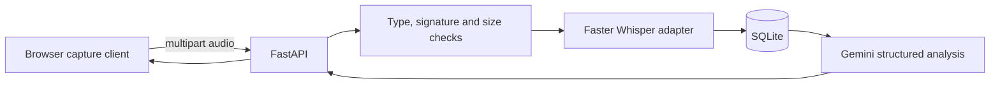

# Call Audit AI

Call Audit AI is a privacy-aware prototype for capturing short call-audio segments,
transcribing them locally with Faster Whisper, and generating a structured quality
assessment with Gemini. It combines a FastAPI/SQLite backend with a small browser
client that can capture a microphone and an explicitly shared audio source.

The project is designed for synthetic demonstrations and consent-based laboratory
use. It is not a production call-monitoring platform.

## Key features

- Starts and tracks an audit session without requiring a real personal identifier.
- Accepts agent and customer audio segments in WAV, WebM, OGG, or MP3 format.
- Enforces an upload-size limit and verifies basic file signatures.
- Lazily loads Faster Whisper so API startup and automated tests stay lightweight.
- Produces a validated, structured Gemini response with a 0–100 score.
- Deletes uploaded audio after transcription by default.
- Stores transcripts and analysis results in SQLite.
- Uses replaceable service boundaries for deterministic tests without external calls.

## Architecture



The default flow is `create call -> upload/transcribe segments -> finalize/analyze ->
read result`. The AI adapters are initialized only when invoked. Tests replace both
adapters with local doubles.

## Tech stack

- Python 3.11+
- FastAPI, Pydantic and SQLAlchemy 2
- SQLite
- Faster Whisper (optional runtime dependency)
- Google Gemini via `google-genai` (optional runtime dependency)
- Vanilla JavaScript, MediaRecorder and MediaDevices APIs
- Pytest, Ruff and GitHub Actions

## Project structure

```text
backend/           FastAPI application, persistence and AI adapters
config/            Synthetic demonstration rubric
docs/              Verification notes and anonymized output example
frontend/          Static browser capture client
tests/             API and adapter tests using mocks
```

## Installation

Create and activate an isolated environment, then install the application and AI
dependencies:

```bash
python -m venv .venv
# Windows: .venv\Scripts\activate
# Linux/macOS: source .venv/bin/activate
pip install -r requirements-ai.txt
```

Copy `.env.example` to `.env` and set `GEMINI_API_KEY`. The application does not
automatically load `.env`; load it through your shell or process manager. For
PowerShell:

```powershell
$env:GEMINI_API_KEY = "your-development-key" # pragma: allowlist secret
```

All other settings have safe local defaults. `RETAIN_AUDIO=false` is strongly
recommended.

## Running the project

From the repository root:

```bash
uvicorn backend.main:app --reload
python -m http.server 5500 --directory frontend
```

Open `http://127.0.0.1:5500`. Use only synthetic audio or consenting participants.
The browser requires permission for the microphone and for a user-selected shared
source. Sharing a display does not guarantee that the browser provides an audio
track; the client checks this condition.

Interactive API documentation is available at `http://127.0.0.1:8000/docs`.

## API summary

| Method | Route | Purpose |
|---|---|---|
| `GET` | `/health` | Liveness check |
| `POST` | `/calls` | Start an audit session |
| `POST` | `/calls/{id}/segments` | Upload and transcribe one segment |
| `POST` | `/calls/{id}/finalize` | Build the transcript and request AI analysis |
| `GET` | `/calls` | List local audit sessions |
| `GET` | `/calls/{id}` | Read one result |
| `GET` | `/calls/{id}/segments` | List transcribed segments |

The upload endpoint expects multipart fields `source` (`AGENT` or `CUSTOMER`) and
`audio`. A failed transcription or AI request returns a generic gateway error; raw
provider exceptions are logged server-side and are not returned to clients.

## Testing

Install the lightweight development set and run:

```bash
pip install -r requirements-dev.txt
ruff check .
ruff format --check .
pytest
python scripts/check_secrets.py
node --check frontend/app.js
```

The suite uses synthetic byte sequences and mocks. It does not download a Whisper
model, send content to Gemini, or use recordings of real people. See
[`docs/verification.md`](docs/verification.md) for the latest verified result.

## Security and privacy considerations

- Never commit `.env`, SQLite databases, recordings, transcripts, or provider keys.
- Obtain informed consent and comply with local recording and privacy law.
- Audio is deleted after transcription unless `RETAIN_AUDIO=true` is explicitly set.
- MIME declarations are untrusted; the API also checks basic container signatures.
- Upload size is bounded by `MAX_UPLOAD_MB` (10 MB by default).
- The example rubric and report contain only synthetic content.
- Authentication, authorization, encryption at rest, malware scanning, rate limits,
  retention policies, and an audit log are required before multi-user deployment.

## Limitations

- Real Whisper transcription was not exercised during portfolio preparation because
  it requires a model download and representative authorized audio.
- Gemini was validated through a structured mock, not with a live credential.
- Browser audio capture varies by operating system, browser, and shared source.
- SQLite and the static frontend are appropriate for a local demonstration, not a
  production contact center.
- This repository intentionally contains no real call data or screenshots.

## Future improvements

- Add authenticated roles and per-tenant authorization.
- Move transcription and analysis to an asynchronous job queue.
- Encrypt retained artifacts and implement configurable retention/deletion jobs.
- Add OpenTelemetry traces and provider latency/cost metrics without call content.
- Validate a consent-based end-to-end demo on multiple supported browsers.

## Author and provenance

Developed by Juan Diego Pinilla as a student software-engineering portfolio project.
The public version was rebuilt from a local prototype while excluding its historical
database, recordings, transcripts, environment file, and other private artifacts.

No license is granted by default. Add one only after confirming ownership of every
included component and the intended reuse terms.
